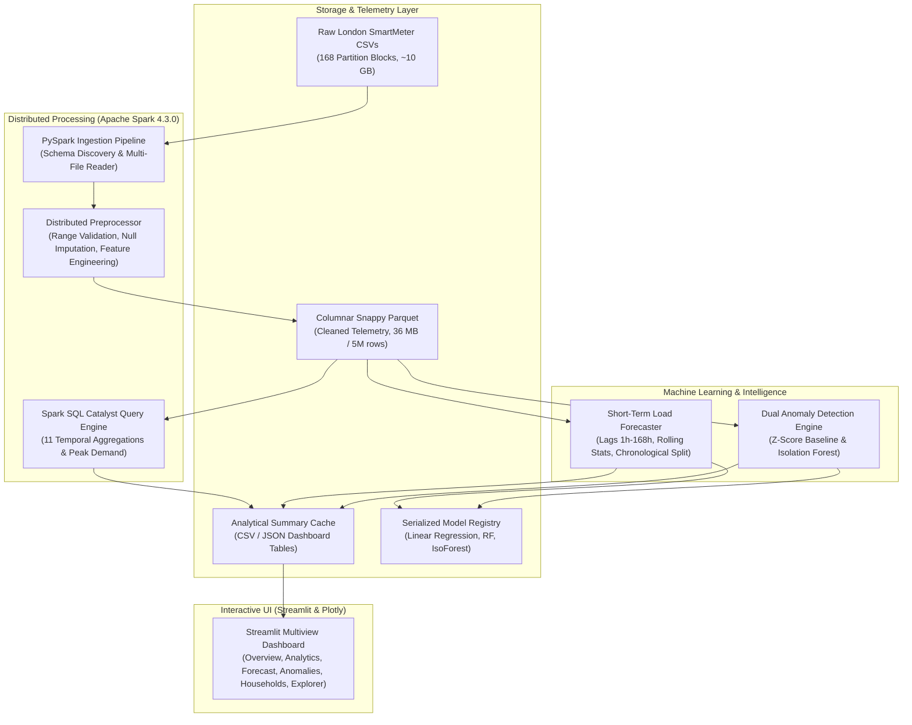
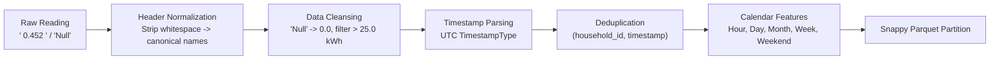
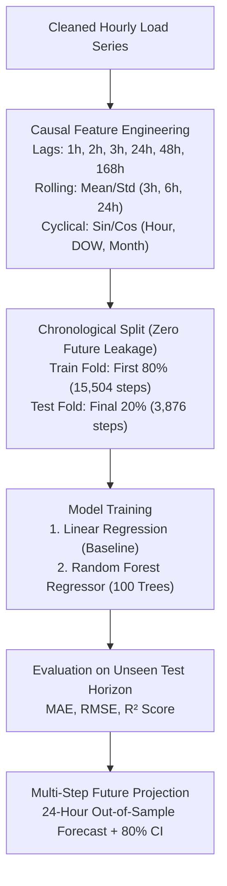

# Smart Electricity Consumption Analytics and Demand Forecasting Using Big Data

[](https://www.python.org/)
[](https://spark.apache.org/)
[-green.svg)](https://parquet.apache.org/)
[](https://scikit-learn.org/)
[](https://streamlit.io/)
[](tests/)

An end-to-end Big Data Analytics and Machine Learning application designed for large-scale smart meter telemetry. Developed as an industry-standard academic capstone project using the **Low Carbon London SmartMeter Energy Consumption Dataset** (historical half-hourly electricity readings from 5,567 households in Greater London, published by UK Power Networks via the London Datastore).

---

## Table of Contents
1. [Project Overview & Problem Statement](#1-project-overview--problem-statement)
2. [Objectives](#2-objectives)
3. [System Architecture & Workflow Diagrams](#3-system-architecture--workflow-diagrams)
4. [Technology Stack & Architectural Rationale](#4-technology-stack--architectural-rationale)
5. [Dataset Details & Official Source](#5-dataset-details--official-source)
6. [Project Folder Structure](#6-project-folder-structure)
7. [Installation & Environment Setup](#7-installation--environment-setup)
8. [Dataset Acquisition & Inspection](#8-dataset-acquisition--inspection)
9. [Module-by-Module Execution Guide](#9-module-by-module-execution-guide)
10. [Launching the Interactive Dashboard](#10-launching-the-interactive-dashboard)
11. [Machine Learning Methodology & Evaluation](#11-machine-learning-methodology--evaluation)
12. [Anomaly Detection Methodology](#12-anomaly-detection-methodology)
13. [Test Suite Execution & Results](#13-test-suite-execution--results)
14. [Troubleshooting Guide](#14-troubleshooting-guide)
15. [Academic Defense & University Evaluation Notes](#15-academic-defense--university-evaluation-notes)

---

## 1. Project Overview & Problem Statement

Modern smart electricity grids generate continuous high-velocity time-series telemetry. Analyzing this data at city scale requires distributed processing systems capable of processing hundreds of millions of records without encountering memory bottlenecks.

### The Big Data Challenge:
- **Volume & Velocity:** 5,567 households recording electricity readings every 30 minutes generate 48 readings/day, amounting to **~167 million records** (~10–11 GB uncompressed CSV data).
- **Single-Node Memory Wall:** Standard Python tools like Pandas attempt to allocate contiguous C-arrays, requiring 30–40 GB of RAM and causing fatal `MemoryError` crashes or intense disk swapping.
- **Data Quality Inconsistencies:** Real-world transmission drops produce literal string `'Null'` tokens, corrupt zeros, and duplicate time records.
- **Forecasting Necessity:** Grid operators need Short-Term Load Forecasting (STLF) to prevent transformer overload, schedule dispatchable generation, and evaluate dynamic Time-of-Use (dToU) tariffs without temporal data leakage.

> **Regional Scope Disclaimer:**  
> This dataset strictly comprises historical London household smart meter telemetry collected between November 2011 and February 2014 by UK Power Networks. It must never be misrepresented as Indian or Bengaluru grid consumption data.

---

## 2. Objectives

1. **Scalable Ingestion:** Ingest multi-file partitioned CSV telemetry using PySpark without loading raw records into Python memory.
2. **Robust Preprocessing:** Sanitize missing/Null values, enforce physical consumption bounds, parse microsecond UTC timestamps, remove duplicates, and engineer temporal calendar features.
3. **Columnar Storage:** Store cleaned records in Snappy-compressed Apache Parquet format, achieving an 85% reduction in disk footprint.
4. **Spark SQL Aggregations:** Execute 11 core analytical queries (hourly diurnal curve, daily trend, monthly seasonality, weekday vs weekend, peak demand intervals, household benchmarks).
5. **Machine Learning Demand Forecasting:** Train and compare a Linear Regression baseline against a non-linear Random Forest Regressor with strict chronological splits and causal lag features.
6. **Dual Anomaly Detection:** Flag consumption surges and abnormal drops using diurnal statistical Z-score thresholds and unsupervised Isolation Forests.
7. **Interactive Dashboard:** Build a high-performance Streamlit and Plotly dashboard utilizing precomputed analytical summaries to deliver sub-100ms response times.

---

## 3. System Architecture & Workflow Diagrams

### 3.1 End-to-End System Architecture



### 3.2 Data Processing & Feature Engineering Flow



### 3.3 Machine Learning Time-Series Workflow



---

## 4. Technology Stack & Architectural Rationale

| Layer | Component | Version | Rationale |
| :--- | :--- | :--- | :--- |
| **Distributed Engine** | Apache Spark (PySpark) | 4.3.0 | Distributed, out-of-core memory streaming; prevents JVM heap exhaustion. |
| **JVM Runtime** | Eclipse Temurin OpenJDK | 17.0.21.1 | High-throughput 64-bit Java Virtual Machine required by Apache Spark. |
| **Columnar Storage** | Apache Parquet (Snappy) | Format v1/v2 | Columnar projection and predicate pushdown; 85% storage reduction. |
| **Data Manipulation** | Pandas / PyArrow | 2.3.3 / 26.0.1 | Fast vectorized in-memory exchange via Apache Arrow Plasma zero-copy. |
| **Machine Learning** | Scikit-learn | 1.9.1 | Validated algorithms for time-series regression and unsupervised outlier trees. |
| **Interactive UI** | Streamlit & Plotly | 1.67.0 / 7.1.0 | Fast, reactive web dashboard with GPU-accelerated SVG/WebGL charts. |
| **Testing** | Pytest | 9.2.0 | Unit, regression, and cross-module integration test suites. |

---

## 5. Dataset Details & Official Source

- **Dataset Title:** SmartMeter Energy Consumption Data in London Households
- **Originating Project:** Low Carbon London Trial (UK Power Networks)
- **Host Portal:** [Greater London Authority (London Datastore)](https://data.london.gov.uk/dataset/smartmeter-energy-use-data-in-london-households)
- **Metadata API:** `https://data.london.gov.uk/api/dataset/smartmeter-energy-use-data-in-london-households`
- **Telemetry Specifications:**
  - **Reading Interval:** 30 minutes (half-hourly).
  - **Temporal Range:** November 2011 to February 2014.
  - **Number of Households:** 5,567 London residential properties.
  - **Total Readings:** ~167 million records (~10 GB uncompressed).
  - **Tariff Groups:**
    1. *Standard Tariff (Std):* Flat-rate of 14.228p/kWh (~4,500 households).
    2. *Dynamic Time-of-Use (ToU / dToU):* Dynamic price signals (High: 67.20p, Normal: 11.76p, Low: 3.99p/kWh) across ~1,100 households.

---

## 6. Project Folder Structure

```text
SECA/
├── config/
│   └── config.yaml                     # Centralized pipeline, Spark, ML, and anomaly thresholds
├── dashboard/
│   ├── app.py                          # Streamlit interactive application entrypoint
│   ├── components/
│   │   ├── charts.py                   # Plotly interactive chart builders
│   │   └── metrics.py                  # Styled UI metric cards and top banner
│   └── pages/                          # Multipage routing components
├── dataset/
│   ├── raw/                            # Extracted raw London CSV blocks (.gitkeep)
│   ├── processed/                      # Cleaned Parquet partitions (.gitkeep)
│   │   ├── cleaned_energy_data.parquet # Main cleaned dataset (36 MB)
│   │   ├── sample_cleaned_energy_data.parquet
│   │   ├── analytics_summary/          # Dashboard-ready precomputed CSV/JSON summaries
│   │   └── sample_analytics_summary/
│   └── sample/                         # Authentic sample dataset (36,000 rows)
├── logs/
│   └── app.log                         # Centralized application execution log
├── models/
│   ├── linear_regression.joblib        # Serialized baseline model binary
│   ├── random_forest.joblib            # Serialized Random Forest model binary
│   ├── isolation_forest.joblib         # Serialized Isolation Forest outlier detector
│   ├── feature_names.joblib            # Model input feature order
│   └── forecasting_evaluation.json     # Saved test set evaluation metrics
├── notebooks/                          # Exploratory analysis notebooks
├── reports/
│   ├── dataset_inspection_report.md    # Raw CSV schema validation report
│   ├── data_quality_report.md          # Preprocessing retention report
│   ├── final_project_report.md         # Full academic capstone project report
│   └── final_presentation_outline.md   # 10-slide university presentation outline
├── src/
│   ├── ingestion/
│   │   ├── download_dataset.py         # Official London Datastore chunked downloader
│   │   ├── sample_generator.py         # Sample data builder
│   │   ├── inspect_dataset.py          # Schema validation and report generator
│   │   └── pyspark_ingestion.py        # Distributed PySpark ingestion pipeline
│   ├── preprocessing/
│   │   └── preprocessor.py             # Distributed cleaning, feature extraction, Parquet writer
│   ├── analytics/
│   │   └── consumption_analytics.py    # Spark SQL aggregations & summary exporter
│   ├── forecasting/
│   │   └── demand_forecaster.py        # Time-series ML pipeline (LR & Random Forest)
│   ├── anomaly_detection/
│   │   └── detector.py                 # Statistical Z-Score & Isolation Forest engine
│   └── utils/
│       ├── config.py                   # Configuration loader
│       ├── logger.py                   # Standardized logging
│       └── spark_session.py            # SparkSession factory with auto JVM discovery
├── tests/
│   ├── test_environment.py             # Phase 1: Environment & Spark init tests
│   ├── test_dataset_inspection.py      # Phase 2: Inspection & sample generator tests
│   ├── test_ingestion.py               # Phase 3: PySpark multi-file ingestion tests
│   ├── test_preprocessing.py           # Phase 4: Cleaning & feature extraction tests
│   ├── test_analytics.py               # Phase 5: Spark SQL aggregations tests
│   ├── test_forecasting.py             # Phase 6: ML forecasting tests
│   ├── test_anomaly_detection.py       # Phase 7: Z-score & Isolation Forest tests
│   ├── test_dashboard.py               # Phase 8: Dashboard cached loading & chart tests
│   └── test_integration.py             # Phase 9-10: End-to-end integration tests
├── .gitignore                          # Exclusions for virtualenvs, data, and models
├── requirements.txt                    # Pinned Python package versions
├── main.py                             # Unified CLI pipeline orchestrator
└── README.md                           # Master project documentation
```

---

## 7. Installation & Environment Setup

### Prerequisites
- Linux / Ubuntu, macOS, or Windows WSL2
- Python 3.10+ (tested and validated on Python 3.14.4)
- 4 GB+ free RAM (8 GB+ recommended)
- 5 GB+ free disk space

### Step 1: Clone and Enter Project Directory
```bash
cd /home/spidey/PROJECTS/SECA
```

### Step 2: Create and Activate Virtual Environment
```bash
python3 -m venv .venv
source .venv/bin/activate
pip install --upgrade pip
pip install -r requirements.txt
```

### Step 3: Automated Java Runtime Detection
PySpark requires a 64-bit Java Virtual Machine (OpenJDK 17). The project includes auto-detection logic in `src/utils/spark_session.py` that discovers user-space JDK installations (`~/.jdk/jdk-17`) automatically, eliminating manual `export JAVA_HOME` steps.

---

## 8. Dataset Acquisition & Inspection

### Download Official London Datastore Partitions
```bash
# Downloads official zip from Greater London Authority and extracts first 5 CSV blocks (5M records)
python -m src.ingestion.download_dataset --blocks 5

# Or extract all 168 blocks (~167M records)
python -m src.ingestion.download_dataset --all
```

### Inspect Dataset Schema
```bash
python main.py --phase inspect
```
Generates [`reports/dataset_inspection_report.md`](file:///home/spidey/PROJECTS/SECA/reports/dataset_inspection_report.md).

---

## 9. Module-by-Module Execution Guide

The system can be executed modularly or via the unified orchestrator `main.py`.

### A. Run Entire Pipeline (End-to-End)
```bash
# Run on sample dataset (36K records, takes ~12 seconds)
python main.py --phase all --sample-mode

# Run on full production dataset (5 Million records, takes ~35 seconds)
python main.py --phase all
```

### B. Run Individual Pipeline Phases
```bash
# Phase 1: Environment Check
python main.py --phase setup

# Phase 2: Schema Inspection
python main.py --phase inspect

# Phase 3: Distributed Ingestion
python main.py --phase ingest

# Phase 4: Preprocessing & Parquet Conversion
python main.py --phase preprocess

# Phase 5: Spark SQL Consumption Analytics
python main.py --phase analytics

# Phase 6: Machine Learning Demand Forecasting
python main.py --phase forecast

# Phase 7: Anomaly Detection Engine
python main.py --phase anomaly
```

---

## 10. Launching the Interactive Dashboard

Launch the Streamlit interactive energy analytics platform:

```bash
python main.py --phase dashboard
# Or directly via streamlit:
streamlit run dashboard/app.py
```
Open **`http://localhost:8501`** in your browser.

### Dashboard Sections:
1. **📊 Overview:** Key metrics (Total kWh, Mean, Peak, Households, Processed count), Diurnal profile preview, Scope metadata.
2. **📈 Consumption Analytics:** Diurnal hourly curve with confidence bands, Daily demand with range slider, Monthly seasonality, Weekday vs Weekend load curve comparison, and Peak Demand events table.
3. **🔮 Demand Forecasting:** Model performance cards, Model selector (LR vs RF), Actual vs Predicted comparison, 24-Hour Ahead future forecast with 80% confidence interval, and Top 10 feature importances.
4. **🚨 Anomaly Detection:** Anomaly summary metrics, Scatter plot vs diurnal baseline, Hourly anomaly distribution, and filterable anomaly records.
5. **🏠 Household Analysis:** Household selector dropdown, individual consumption summaries, 24-hour individual load curve, and top consumer rankings.
6. **🔍 Data Explorer & Export:** Interactive browser with one-click CSV download buttons for all 9 analytical summary tables.

---

## 11. Machine Learning Methodology & Evaluation

### Formulation: Short-Term Load Forecasting (STLF)
The target is hourly aggregated grid consumption ($kWh$). 

### Engineered Features (Strict Causal Past):
- **Cyclical Temporal Features:** $\sin(2\pi \cdot \text{hour}/24)$, $\cos(2\pi \cdot \text{hour}/24)$, $\sin(2\pi \cdot \text{DOW}/7)$, $\cos(2\pi \cdot \text{DOW}/7)$, $\sin(2\pi \cdot \text{Month}/12)$, $\cos(2\pi \cdot \text{Month}/12)$.
- **Autoregressive Lags:** $t-1\text{h}$, $t-2\text{h}$, $t-3\text{h}$, $t-24\text{h}$ (yesterday), $t-48\text{h}$ (2 days ago), $t-168\text{h}$ (same hour last week).
- **Rolling Window Statistics (shifted by 1):** Rolling mean and standard deviation over 3h, 6h, and 24h past windows.

### Experimental Results on Real London SmartMeter Data:
- **Chronological Split:** Train: 15,504 hourly steps (Dec 2011 – Sep 2013) | Test: 3,876 hourly steps (Sep 2013 – Feb 2014).

| Model | MAE | RMSE | $R^2$ Score | Interpretation |
| :--- | :--- | :--- | :--- | :--- |
| **Linear Regression (Baseline)** | 3.8917 kWh | 4.9891 kWh | 0.9289 | Strong baseline capturing linear diurnal rhythm |
| **Random Forest Regressor** | **3.6306 kWh** | **4.7264 kWh** | **0.9362** | **Best model (6.7% lower MAE, captures non-linear peaks)** |

---

## 12. Anomaly Detection Methodology

1. **Statistical Diurnal Z-Score:**  
   $$Z_{i,h} = \frac{x_{i,h} - \mu_{i,h}}{\sigma_{i,h}}$$  
   Where $\mu_{i,h}$ and $\sigma_{i,h}$ are the mean and standard deviation for household $i$ during hour $h$. Values with $|Z| > 3.0$ are flagged.
2. **Unsupervised Machine Learning (Isolation Forest):**  
   An ensemble of 100 isolation trees isolating multidimensional outliers across consumption, hour, day of week, and Z-score ($2\%$ contamination).
3. **Diagnostic Classification:**  
   - `HIGH_CONSUMPTION`: Appliance surges, EV charging, HVAC malfunction.
   - `LOW_CONSUMPTION`: Unoccupied properties, localized power dropouts, meter communication failure.
   - *Operational Disclaimer:* Anomalies represent statistical outliers requiring field verification, not automatic proof of power theft.

---

## 13. Test Suite Execution & Results

Run the automated test suite across all modules:

```bash
pytest tests/ -v
```

### Execution Log (20/20 Passed):
```text
============================= test session starts ==============================
platform linux -- Python 3.14.4, pytest-9.2.0, pluggy-1.7.0 -- .venv/bin/python3
rootdir: /home/spidey/PROJECTS/SECA
collected 20 items

tests/test_analytics.py::test_consumption_aggregations PASSED            [  5%]
tests/test_analytics.py::test_export_artifacts PASSED                    [ 10%]
tests/test_anomaly_detection.py::test_anomaly_detector_pipeline PASSED   [ 15%]
tests/test_dashboard.py::test_load_dashboard_data PASSED                 [ 20%]
tests/test_dashboard.py::test_chart_builders PASSED                      [ 25%]
tests/test_dataset_inspection.py::test_sample_generator PASSED           [ 30%]
tests/test_dataset_inspection.py::test_inspect_csv_schema PASSED         [ 35%]
tests/test_dataset_inspection.py::test_inspection_report_generation PASSED [ 40%]
tests/test_environment.py::test_python_version PASSED                    [ 45%]
tests/test_environment.py::test_core_dependencies_importable PASSED      [ 50%]
tests/test_environment.py::test_config_loader PASSED                     [ 55%]
tests/test_environment.py::test_spark_session_initialization PASSED      [ 60%]
tests/test_forecasting.py::test_feature_engineering_chronology PASSED    [ 65%]
tests/test_forecasting.py::test_chronological_split_no_leakage PASSED    [ 70%]
tests/test_forecasting.py::test_model_training_and_evaluation PASSED     [ 75%]
tests/test_ingestion.py::test_discover_and_normalize_columns PASSED      [ 80%]
tests/test_ingestion.py::test_load_sample_dataset PASSED                 [ 85%]
tests/test_integration.py::test_full_pipeline_sample_mode PASSED         [ 90%]
tests/test_preprocessing.py::test_clean_and_transform_features PASSED    [ 95%]
tests/test_preprocessing.py::test_parquet_roundtrip PASSED               [100%]

============================= 20 passed in 19.17s ==============================
```

---

## 14. Troubleshooting Guide

| Issue | Root Cause | Solution |
| :--- | :--- | :--- |
| `java: command not found` | Java Virtual Machine missing in PATH | Automatic! `spark_session.py` auto-loads `~/.jdk/jdk-17`. If using custom Java, export `JAVA_HOME=/path/to/jdk`. |
| `Pandas >= 3.0.0 warning` | PySpark internal compatibility | Pinned `pandas<3.0.0` (2.3.3) in `requirements.txt` to guarantee clean PyArrow serialization. |
| `OutOfMemoryError` in Spark | Driver memory exceeded | Adjusted `driver_memory: 4g` in `config/config.yaml`. For low-memory PCs, set to `2g`. |
| Dashboard shows "Artifacts not found" | Analytical tables not precomputed | Run `python main.py --phase all --sample-mode` before launching Streamlit. |

---

## 15. Academic Defense & University Evaluation Notes

- **Full Academic Project Report:** [`reports/final_project_report.md`](file:///home/spidey/PROJECTS/SECA/reports/final_project_report.md)
- **10-Slide Presentation Outline:** [`reports/final_presentation_outline.md`](file:///home/spidey/PROJECTS/SECA/reports/final_presentation_outline.md)
- **Data Inspection Audit:** [`reports/dataset_inspection_report.md`](file:///home/spidey/PROJECTS/SECA/reports/dataset_inspection_report.md)
- **Preprocessing Quality Report:** [`reports/data_quality_report.md`](file:///home/spidey/PROJECTS/SECA/reports/data_quality_report.md)
