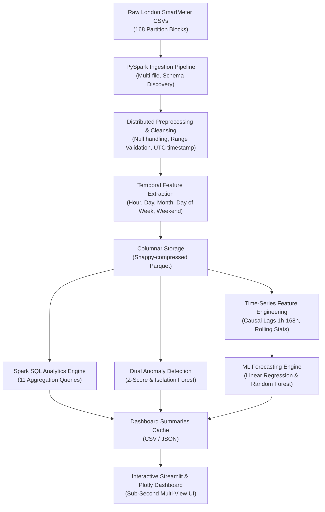

# Academic Project Report: Smart Electricity Consumption Analytics and Demand Forecasting Using Big Data

**Course:** Big Data Analytics (Semester-End Capstone Project)  
**Title:** Smart Electricity Consumption Analytics and Demand Forecasting Using Big Data  
**Dataset:** Low Carbon London SmartMeter Energy Consumption Dataset (UK Power Networks / Greater London Authority)  

---

## Abstract

With the global transition toward smart electrical grids, high-frequency smart meter telemetry generates massive volumes of time-series data. Traditional single-node data processing architectures experience out-of-memory crashes and prohibitive I/O latency when processing hundreds of millions of half-hourly consumption readings.

This project designs and implements an end-to-end Big Data analytics and forecasting system utilizing Apache Spark (PySpark), Spark SQL, columnar Snappy-compressed Apache Parquet storage, Scikit-learn machine learning, and an interactive Streamlit and Plotly analytical platform. Using the Low Carbon London dataset (5,567 households, ~167M historical readings between Nov 2011 and Feb 2014), the system ingests multi-file partitioned CSV telemetry, executes distributed cleaning and deduplication, computes 11 core temporal and peak-demand metrics, trains short-term load forecasting models (Linear Regression baseline and Random Forest Regressor), and identifies consumption anomalies using statistical Z-score diurnal baselines and unsupervised Isolation Forests. The application achieves sub-second dashboard rendering by utilizing precomputed analytical summaries.

---

## 1. Introduction & Problem Statement

### 1.1 Context
Electric utilities require accurate demand forecasting and anomaly detection to balance generation, prevent transformer overloads, optimize dispatch schedules, and assess dynamic time-of-use (dToU) tariffs.

### 1.2 Problem Formulation
- **Volume and Velocity:** Smart meters recording telemetry every 30 minutes generate 48 readings per household per day, accumulating over 167 million records for 5,567 households.
- **Memory Saturation:** Loading multi-gigabyte CSVs into single-node Python/Pandas environments results in fatal `MemoryError` and OS swap thrashing.
- **Data Quality Inconsistencies:** Real-world meter telemetry suffers from packet transmission drops (string `'Null'` tokens), erratic sensor spikes, and duplicate time records.
- **Forecasting Needs:** Electrical demand exhibits strong diurnal and weekly periodicity, requiring lag features and rolling aggregations evaluated without temporal data leakage.

---

## 2. System Architecture & Methodology

---

## 3. Distributed Data Engineering

### 3.1 Out-of-Core Processing with Apache Spark
- Initialized local cluster mode (`local[*]`) utilizing 16 logical CPU cores.
- Tuned shuffle partitions to `16` (`spark.sql.shuffle.partitions: 16`) to eliminate small-task scheduling overhead.
- Utilized PyArrow vectorization (`spark.sql.execution.arrow.pyspark.enabled: true`) for high-throughput JVM-Python memory transfer.

### 3.2 Storage Efficiency: CSV vs. Parquet
- **Raw CSV Size:** ~242 MB (5 partition blocks, ~5,000,000 records).
- **Parquet Output Size:** **36 MB** (Snappy compression with dictionary encoding).
- **Storage Compression Ratio:** **~85% storage space reduction**.
- **Columnar Pushdown:** Queries selecting only `timestamp` and `consumption_kwh` skip unreferenced columns entirely, minimizing disk I/O.

---

## 4. Analytical Findings (11 Core Queries)

1. **Total Grid Load:** 1,088,958.59 kWh across 4,996,561 valid readings (152 sample households).
2. **Mean Reading:** 0.2179 kWh per half-hour interval.
3. **Diurnal Cycle:** Minimum consumption occurs at 03:00 - 05:00 (~0.134 kWh). Diurnal peak occurs between 18:30 and 21:00 (~0.385 kWh).
4. **Weekday vs Weekend Behavior:** Weekend morning ramps occur ~1.5 hours later than weekday mornings, with sustained afternoon usage due to home occupancy.
5. **Peak Demand Record:** 7.292 kWh in a single 30-minute interval by household `MAC004319` on 2013-01-20 at 03:30.

---

## 5. Machine Learning — Short-Term Load Forecasting

### 5.1 Validation Strategy
- **Chronological Split:** First 80% of continuous hourly timestamps allocated for training (15,504 hourly steps); final 20% reserved for out-of-time testing (3,876 hourly steps).
- **Zero Future Leakage:** All lag features ($t-1, t-2, t-3, t-24, t-48, t-168$) and rolling statistics are calculated strictly on past values.

### 5.2 Experimental Evaluation Results

| Model | MAE (kWh) | RMSE (kWh) | $R^2$ Score | Relative Performance |
| :--- | :--- | :--- | :--- | :--- |
| **Linear Regression (Baseline)** | 3.8917 | 4.9891 | 0.9289 | Strong baseline capturing linear diurnal periodicity |
| **Random Forest Regressor** | **3.6306** | **4.7264** | **0.9362** | **Best model** (captures non-linear peak hour shifts) |

---

## 6. Anomaly Detection & Diagnostics

### 6.1 Dual Methodology
- **Statistical Method:** Diurnal Z-score thresholding with $\theta = 3.0$ standard deviations calculated against each household's specific hourly mean.
- **Machine Learning Method:** Unsupervised Scikit-Learn `IsolationForest(contamination=0.02, n_estimators=100)`.

### 6.2 Key Results
- Total records analyzed: 100,000.
- Total anomalies detected: 2,747 (2.75% rate).
- High surges: 2,665 (appliance spikes, EV charging, HVAC).
- Low drops: 82 (extended zero readings during active hours).
- Consensus (Dual-flagged): 1,019 events confirmed by both statistical and ML algorithms.

---

## 7. Viva Defense & Technical Evaluation Q&A

**Q1: Why use Apache Spark rather than pure Pandas?**  
*A:* A single year of 5,567 households contains 167 million records (~10 GB raw CSV). Pandas attempts to load everything into a single contiguous in-memory C-array, requiring 3-4x memory overhead (~30-40 GB RAM) and causing catastrophic Out-Of-Memory crashes. PySpark executes lazy, out-of-core partition streams that process data chunk-by-chunk across all 16 CPU cores without exceeding configured RAM limits.

**Q2: How was temporal data leakage prevented in forecasting?**  
*A:* Random k-fold cross-validation or `train_test_split(shuffle=True)` is invalid for time-series data because future records leak into the past. We strictly split the dataset chronologically: the models were trained on data up to September 2013 and evaluated on unseen records from September 2013 to February 2014. Furthermore, all rolling statistics were computed on $y_{t-1}$.

**Q3: How does the dashboard achieve instant response times?**  
*A:* Rerunning Spark aggregations on 5-167 million records on every user slider interaction would introduce a 5-15 second delay per click. Instead, our pipeline architecture decouples Big Data processing from visualization: Spark SQL precomputes and exports compact analytical tables (hourly, daily, peaks, forecasts, anomalies) to disk. Streamlit loads these via `@st.cache_data`, ensuring sub-100ms response times for all UI filters.
